# Практическое задание 9. Git
# Оценка 3

Используя комманду git status узнаю в какой ветке сейчас нахожусь:
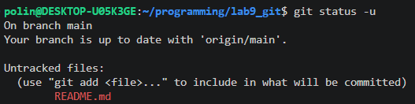
Благодаря ей мы узнаем, что: 
- Я нахожусь на ветке main.
- Локальная ветка полностью синхронизирована с удаленной (`origin/main`).
- Создан новый файл `README.md`, который пока находится в разделе `Untracked files` (Git видит его, но еще не начал отслеживать изменения).

Создаю файль sort.c и заполняю его кодом с функцией сортировки:
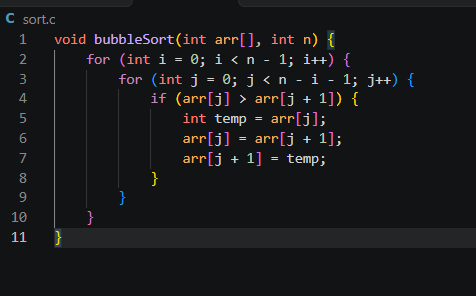

Еще раз пишу команду и смотрю на изменения в ней:
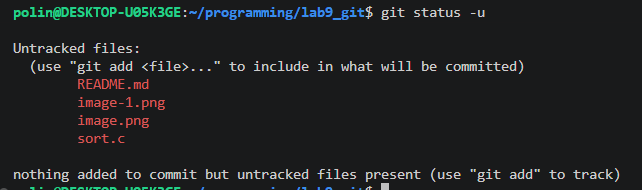
Git показывает, что в папке появились новые файлы, которые пока не отслеживаются (`Untracked files`):
- `sort.c` — файл с функцией сортировки.
- `README.md` — файл отчета.
- `image-1.png`, `image.png` — скриншоты для отчета.
Git видит их, но не сохраняет их историю.

Добавляю файл в бласть stage (add) и смотрю как изменился статус. Git показывает, что файл `sort.c` перешел в раздел `Changes to be committed` (готов к коммиту). 
Остальные файлы (`README.md` и скриншоты) пока остаются в `Untracked files`, так как я их не добавляла.
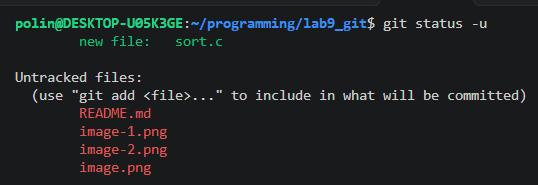

Выполнила `git commit -m "Add sort function"`. 
После коммита `git status` показывает, что рабочая директория чиста (все изменения зафиксированы), но появилось уведомление, что локальная ветка опережает удаленную на 1 коммит. Также внизу остаются неотслеживаемые файлы отчета и картинок.
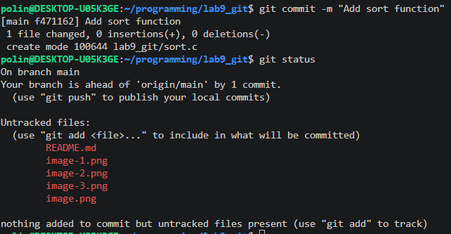

Добавила комментарий в файл `sort.c`. Команда `git status` показывает, что файл `sort.c` находится в разделе `Changes not staged for commit` (изменен, но не подготовлен к коммиту). Git видит разницу между текущей версией и последним коммитом.
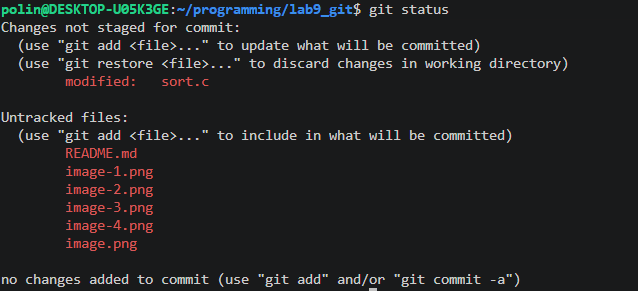

Выполнила `git add sort.c`. Теперь `git status` показывает файл `sort.c` в разделе `Changes to be committed`. Изменение подготовлено к сохранению в историю.
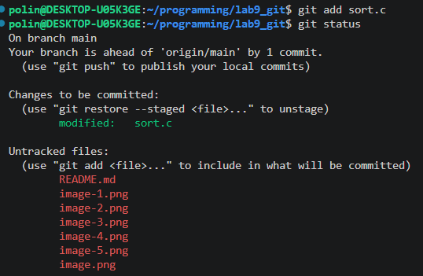

Добавила второй комментарий в `sort.c` и сделала коммит командой `git commit -m "Update sort.c with comments"`.
В журнале `git log` видно два коммита: 
1. "Update sort.c with comments" (самый свежий, HEAD -> main).
        commit 2a66b14f3b3cd1a59d833b872276a693f208a0f3 — это уникальный идентификатор (хеш) коммита. Обычно хватает первых 7 символов (2a66b14).
        (HEAD -> main)  HEAD — это указатель на то, где мы находимся сейчас. main — это название ветки.
        Author: polinka1606 <polinkaslinka@gmail.com> — кто сделал коммит.
        Date: Thu Nov 19 21:47:32 2026 +0700 — когда это было сделано.
        Update sort.c with comments — сообщение коммита.
2. "Add sort function" (предыдущий).
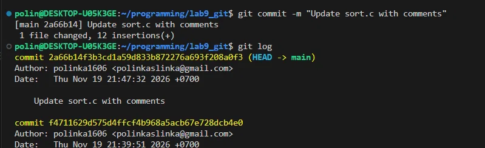

- Выполнила `git status`: увидела, что `sort.c` снова изменен (второй комментарий не попал в предыдущий коммит).
- Добавила его в stage (`git add sort.c`) и сделала финальный коммит: `git commit -m "Add second comment"`.
- Отправила изменения на GitHub командой `git push`. Все коммиты успешно загружены (видно сообщение `branch 'main' -> main`).
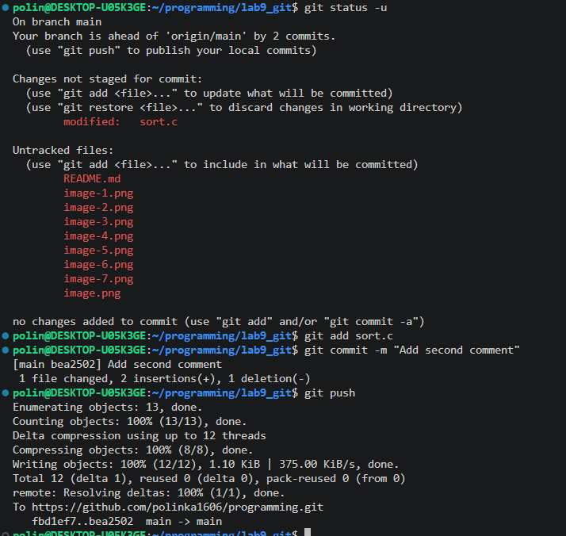

# Ветки

Выполнила команду `git branch mybranch`, затем `git branch`. Вывод показывает две ветки: `main` (текущая, отмечена звездочкой) и `mybranch` (создана, но пока не активна).
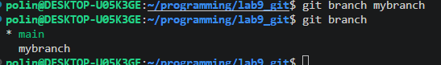

Выполнила `git switch mybranch`. Git подтвердил переключение: `Switched to branch 'mybranch'`. 
Вывод `git status` изменился: в первой строке теперь написано `On branch mybranch` (раньше было `main`). Все неотслеживаемые файлы (отчет и картинки) остались на месте, так как они не были привязаны ни к одной ветке.
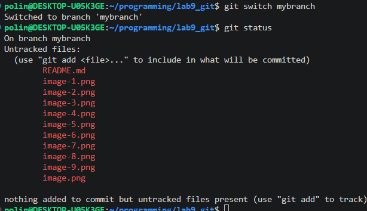

Проверила ветку командой `git branch` — звездочка стоит на `mybranch`.
Создала файл `file1.txt` и написала в него свое имя. Добавила его в индекс (`git add file1.txt`) и сделала коммит (`git commit -m "Add file1 with my name"`). В выводе видно, что коммит создан в ветке `mybranch`.
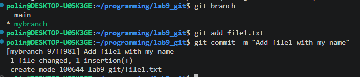

Выполнила `git log --oneline --graph`. 
- Флаг `--oneline` вывел каждый коммит в одну строку (хеш + сообщение).
- Флаг `--graph` показал структуру ветвления (символы `*` и `\`).

- Самый верхний коммит `97ff981` имеет пометку `(HEAD -> mybranch)`. Это значит, что я нахожусь на ветке `mybranch`, и она указывает на этот новый коммит "Add file1 with my name".
- Ниже видно, что ветка `main` (а также `origin/main` — то есть версия на GitHub) указывает на коммит `bea2502` ("Add second comment").
- В самом низу виден коммит слияния `fbd1ef7`, который образовался когда был конфликта в README(Для этого использовала нейронку т.к не до конца поняла, что было не так).
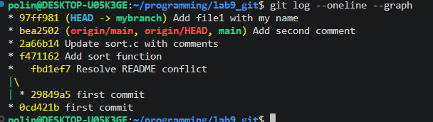

Переключилась обратно на главную ветку командой `git switch main`. Git подтвердил: `Switched to branch 'main'`.
Выполнила `git log --oneline --graph`. 
Из лога пропал коммит `97ff981 "Add file1 with my name"`, так как он принадлежит ветке `mybranch`. Лог показывает только историю текущей ветки `main`. Верхний коммит теперь `bea2502` с пометкой `(HEAD -> main)`.
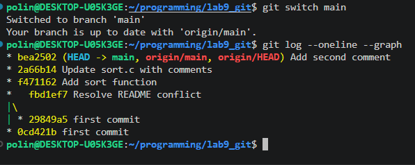

Создала файл `file2.txt`, добавила в индекс и закоммитила (`git commit -m "Add file2"`).
Выполнила `git log --oneline --graph --all`. Флаг `--all` позволил увидеть обе ветки одновременно.
- Ветка `main` (где я сейчас, `HEAD -> main`) ушла вперед на коммит `1d78d16 "Add file2"`.
- Ветка `mybranch` осталась на коммите `97ff981 "Add file1 with my name"`.
- История разветвилась: у двух веток теперь разные коммиты.
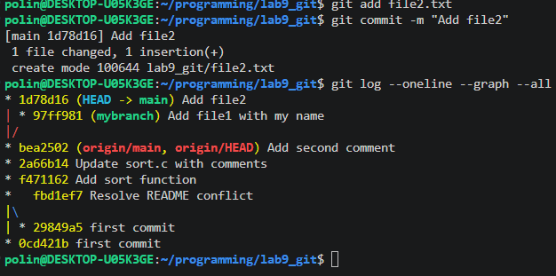

Переключилась на ветку `mybranch` командой `git switch mybranch`. 
Файл `file2.txt` пропал из рабочей директории (и из проводника VS Code). Это произошло потому, что он был создан и закоммичен только в ветке `main`. Ветка `mybranch` «не знает» о его существовании, поэтому при переключении Git показывает файловую структуру, соответствующую последнему коммиту в `mybranch` (где есть только `file1.txt`).
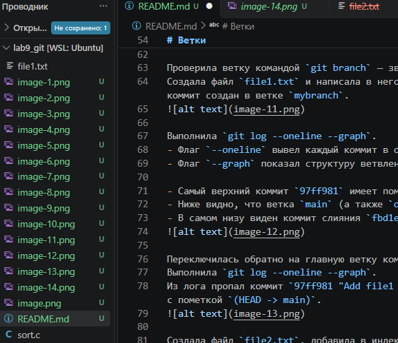

Затем выполнила `git diff mybranch main`, чтобы увидеть разницу. Вывод показал:
- Файл `file1.txt` (содержащий "Поля") существует в `mybranch`, но отсутствует в `main` (поэтому Git помечает его как `deleted` для main).
- Файл `file2.txt` (содержащий "Второй файл") существует в `main`, но отсутствует в `mybranch` (поэтому Git помечает его как `new file`).
Строки с минусом (`-`) показывают, что было удалено, а строки с плюсом (`+`) — что было добавлено.
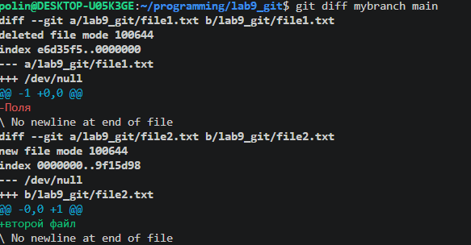

Находясь в ветке `mybranch`, добавила все файлы отчета (`git add .`) и сделала коммит (`git commit -m "Add report to mybranch"`).
Запушила ветку на GitHub командой `git push -u origin mybranch`. Git создал новую ветку на сервере и связал её с локальной.
В задании также сказано запушить изменения `main`. Переключусь на `main` и сделаю `git push`, чтобы обновить и её.
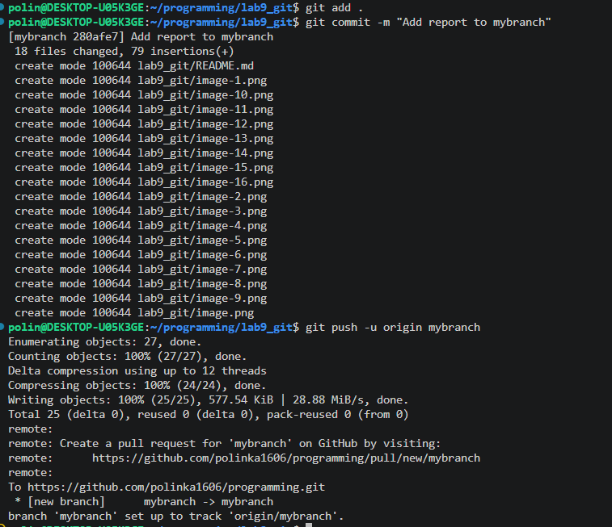

# Оценка 4

Переключилась на ветку `mybranch`, используя команду`git checkout mybranch`
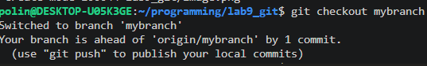

В файл sort.c добавила функцию main(), в которой объявлен массив из нескольких чисел ( int a[] = {4, 2, 0};) и вызвана функция сортировки для этого массива.
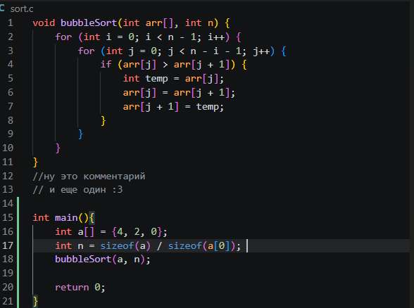

Используя `git diff`, увидела:
- c `index 7b4aabd..ae25ae2 100644` — это служебная информация.
- `7b4aabd...ae25ae2` — это хеш коммита, который внёс эти изменения 
- `100644` — права доступа к файлу в этом коммите.
- `--- a/lab9_git/sort.c` и +++ `b/lab9_git/sort.c`  — указывают на пути в репозитории.
- `@@ -10,4 +10,12 @@` — это контекст для git diff. Он показывает, что изменения начинаются примерно с 10-й строки исходного файла.
- Строка `void bubbleSort(int arr, int n) { } }` — это исходный код функции сортировки. Комментарии показывают, что в одной из версий уже были комментарии, а в другой их добавили.
- Завершающая строка `\ No newline at end of file` — это ещё одно замечание о том, что в версии b в конце файла тоже нет завершающей новой строки.
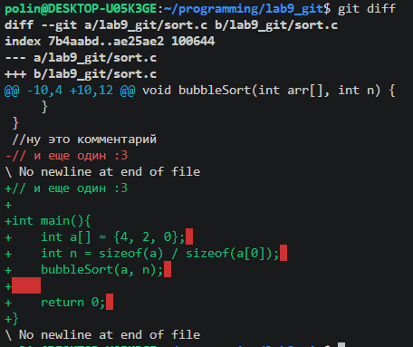

`git diff --staged` Оказался пустым. 
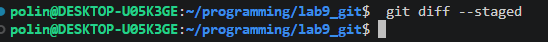
 
 Добавила в  staged файл sort.c и проверила его статус: 
 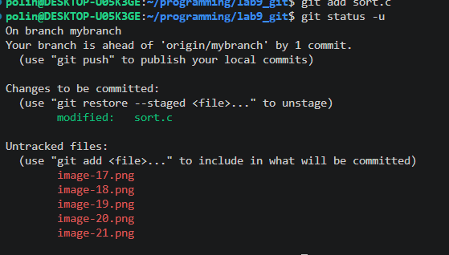

 `git diff` оказался пустым, а `git diff --staged` вывел информацию, которая раньше была в `git diff`:
 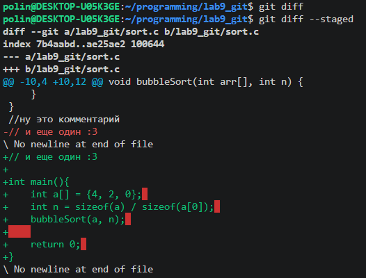

Команда показывает добавленный блок main(). git diff --staged сравнивает область индекса (Stage) с последним коммитом (HEAD). Поскольку в Stage теперь лежит новая версия файла с функцией main(), а в последнем коммите — старая (без нее), Git показывает эту разницу. То есть информация, которая раньше была в обычном git diff, теперь переместилась в git diff --staged

Удалила ноль из массива `а`, выполнила `git diff` и  `git diff --staged`
 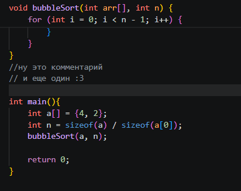
 Что поменялось?
 `git diff` показал, изменение в файле(был удален 0), а  `git diff --staged` не изменился.
 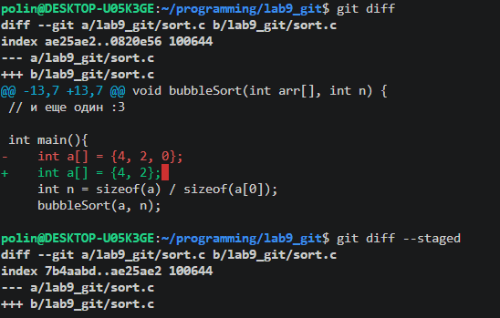

 Что происходит:

Файл sort.c теперь существует в двух разных состояниях. В индексе (Stage) находится версия с main(), которую я подготовила на шаге 5 (там еще есть ноль). В рабочей директории находится версия с main(), где я удалила ноль. Поскольку я не выполнила git add после удаления нуля, Git видит расхождение между рабочей директорией и индексом (это показывает git diff), в то время как разница между индексом и последним коммитом (это показывает git diff --staged) осталась прежней — добавление main().

Проверила статус с помощью команды `git status` и файл `sort.c` присутствует дважды в выводе.
Потому что версия файла sort.c в индексе отличается от версии в рабочей директории.  В первом блоке файл находится потому, что в индексе лежит версия с функцией main().
Во втором блоке файл находится потому, что на я удалила ноль из массива, но не выполнила git add. Git видит, что рабочая директория (версия без нуля) отличается от индекса (версия с нулем), и показывает файл в обоих разделах.
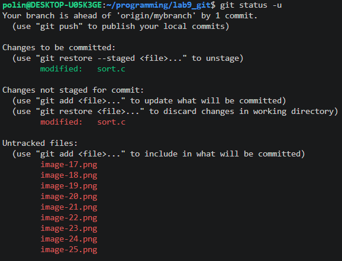

Запускаю  `git restore --staged sort.c` и проверяю стратус `git status`.

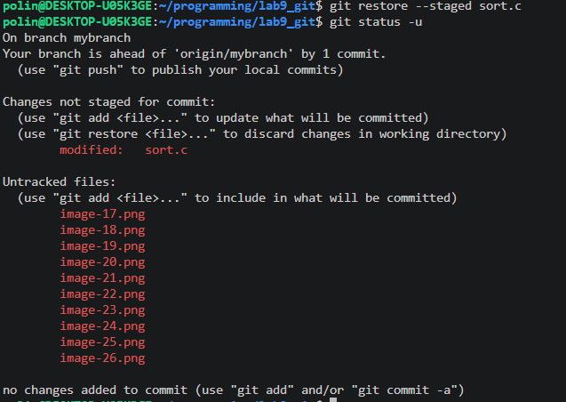

Индексирую изменение и делаю коммит:
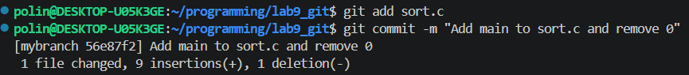

 `git log` показывает, что новый коммит `Add main to sort.c and remove 0` находится на вершине истории ветки mybranch. Также в логе видно, что локальная ветка mybranch опережает удаленную ветку origin/mybranch (изменения еще не запушены на GitHub).
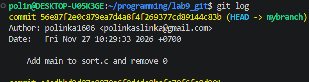

В sort.c добавляю `printf(“hello git\n”)` и смотрю сожержиое файла
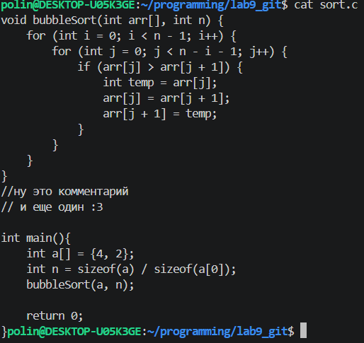
Проверяю статус файла:
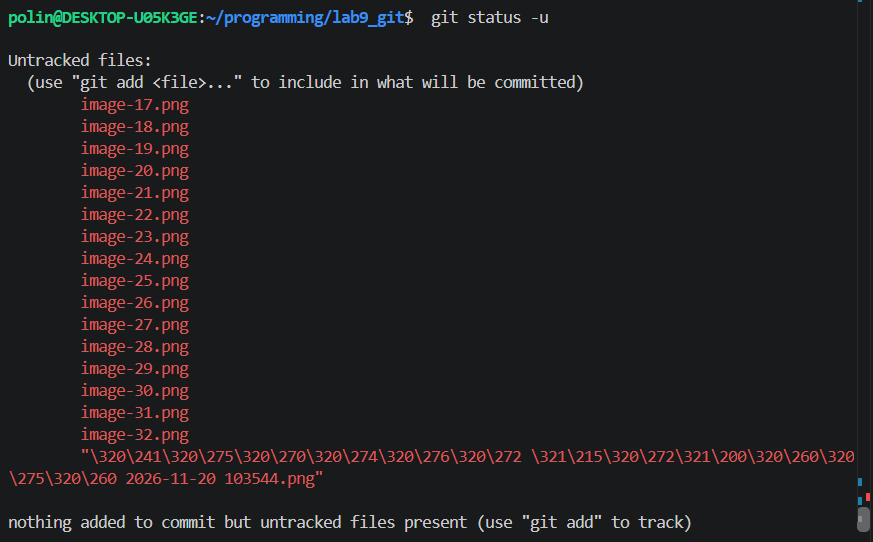
Изменения закоммичены.

После выполнения `git restore sort.c` я проверила файл с помощью cat sort.c. Строка printf("hello git\n");, добавленная на шаге 17, исчезла. Файл вернулся к состоянию последнего коммита
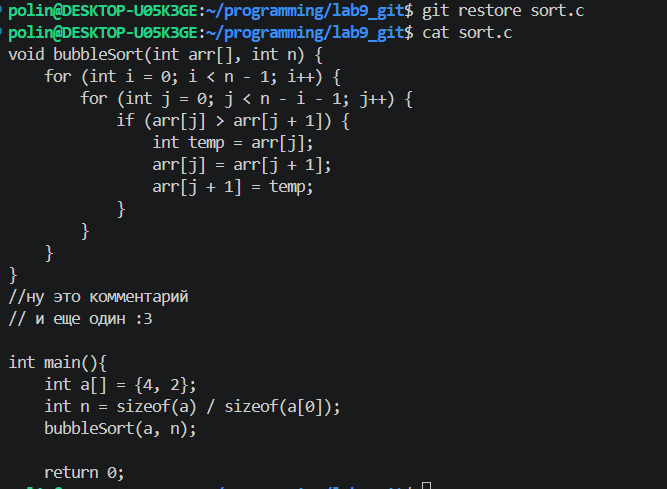
Проверяю статус:
Git сообщает, что рабочая директория чиста. Изменения в файле sort.c (добавление printf("hello git\n");) были успешно отменены командой git restore, и файл вернулся к состоянию последнего коммита.

Запушила на удаленную репо ветку:
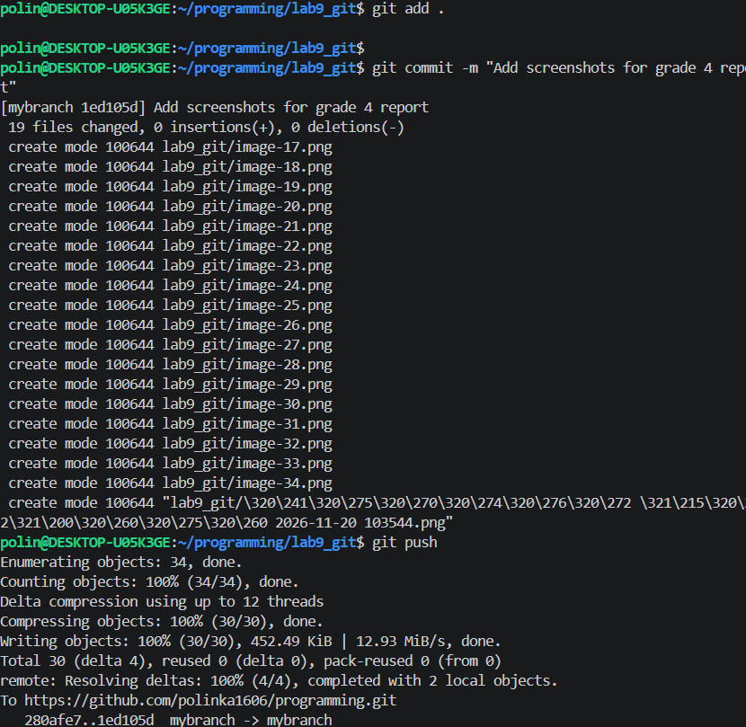

# Ветки и ff-merge